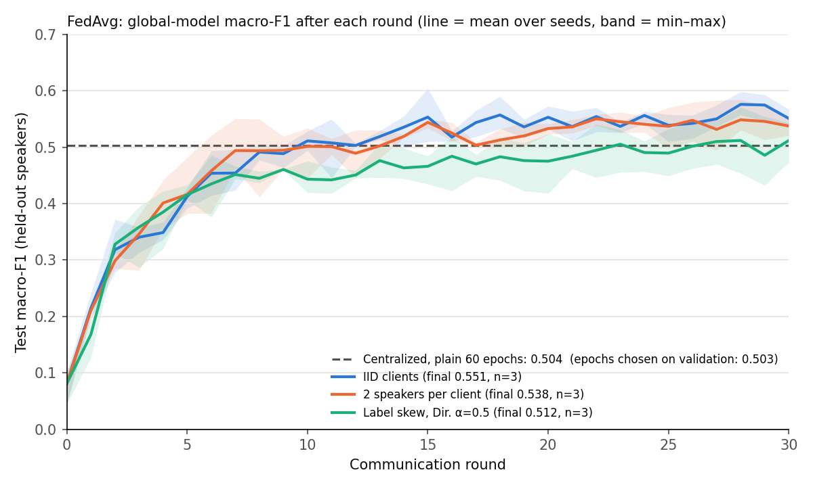
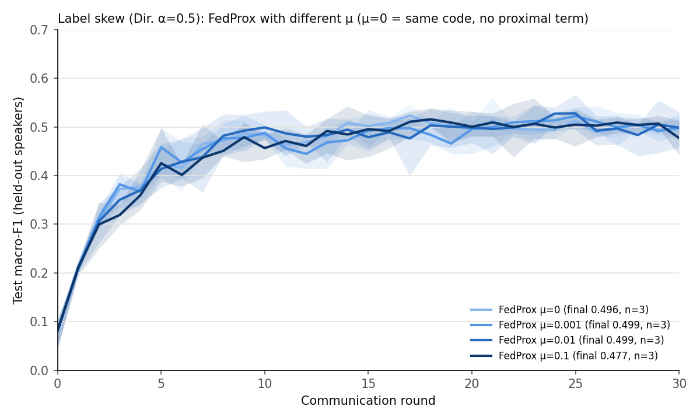
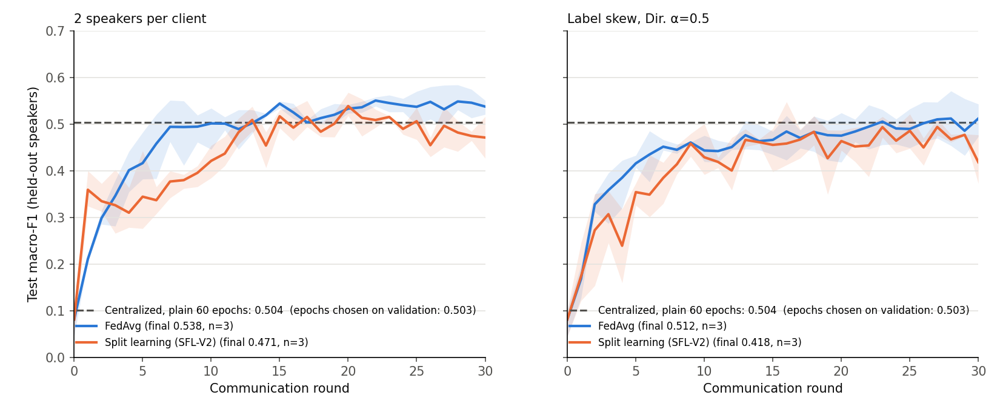

# Federated vs. centralized training for speech emotion recognition

A small, controlled experiment: how much accuracy does a speech emotion classifier
lose when it is trained with **federated learning** (the audio never leaves each
client) instead of on one machine, and how does that depend on **how the data is
split across clients**?

Same model, same features, same held-out test set and same training budget in every
setting. Every number below comes from the result files in `results/`, produced by
the commands at the end of this page; the table is generated by `plot_results.py`.

## Research question

1. Does FedAvg match centralized training of the same 1D CNN on RAVDESS?
2. How much does non-IID client data hurt FedAvg, and does it matter *which kind* of
   non-IID: clients that differ in **speakers** (feature shift) vs. clients that
   differ in **emotion mix** (label skew)?
3. Stretch: does FedProx help under label skew, and how does split federated learning
   (the client keeps only the first conv block) compare?

## Setup

**Data.** RAVDESS speech, 24 actors (12 male, 12 female). The local copy had 1,536
`.wav` files, 97 of them byte-identical duplicates (e.g. `...-10(1).wav`), removed by
file hash so the same recording can never be in both train and test. "Calm" is
excluded, as in my earlier project, leaving **1,247 recordings and 7 emotions**
(neutral: 96 recordings; every other class: 191–192).

**Features and model.** 13 MFCCs × 173 frames (librosa, 22.05 kHz), standardized per
coefficient using training-set statistics. The model is the 1D CNN from my earlier
project (Conv1D 64 → BN → pool → Conv1D 128 → BN → pool → Dense 128 → dropout 0.3 →
softmax; 700,807 parameters), trained with Adam (lr 1e-3) and batch size 16.

**Test set (shared by every experiment).** All recordings of 4 held-out speakers
(actors 6, 8, 15, 19: 2 female, 2 male, drawn once with a fixed seed), 208
recordings in total. The other 20 speakers (1,039 recordings) form the training
pool. Nobody trains on the test voices.

**Training budget.** Federated: 10 clients, 30 rounds, 2 local epochs, every client
trains in every round. Centralized: 60 epochs, the same number of passes over the
data. No setting is tuned and the test set never chooses anything. Each setting uses
seeds 0, 1 and 2.

**Two centralized baselines.**
- *Plain:* train for 60 epochs and report the final model.
- *Early-stopped:* hold out 2 of the 20 training speakers (actors 9 and 16, drawn with
  a fixed seed) as validation, train on the other 18, pick the epoch with the best
  validation macro-F1, then retrain on all 20 speakers for that many epochs and
  report the test score.

**How the training pool is split across the 10 clients** (`data.partition`):

| Split | What each client holds | Type of heterogeneity |
|---|---|---|
| IID | a random tenth of all training recordings (~104, about 20 speakers, mixed emotions) | none |
| 2 speakers per client | all recordings of its own 2 speakers and nothing else, like a phone that keeps its owner's voice data | feature shift: different voices, **identical** emotion mix (every actor recorded every emotion equally often) |
| Label skew, Dirichlet α=0.5 | for each emotion, the clients' shares are drawn from Dir(0.5), so each client is dominated by a few emotions; speakers are mixed; client sizes range from 17 to 229 | label skew, plus unequal client sizes |

**Federated learning (Flower 1.42, simulation mode, `federated.py`).** Each round the
server sends the global weights to all 10 clients. Each client trains on its own data
for 2 epochs (with a fresh Adam optimizer) and sends back its weights and number of
recordings. The server replaces the global model with the weighted average (FedAvg)
and evaluates it on the test set. Replies are averaged in a fixed client order, which
makes runs bit-for-bit reproducible (verified by re-running full 30-round runs).

**FedProx.** Same as FedAvg, but each client minimizes
`loss(w) + μ/2·‖w − w_global‖²`, which pulls its weights toward the global model.
μ ∈ {0.001, 0.01, 0.1}, taken from the FedProx paper's grid, are all reported; none was
chosen using the test set. The proximal term needs a hand-written training loop, so
μ = 0 with that same loop is included as the control.

**Split federated learning (`split_learning.py`, SFL-V2 style, plain TensorFlow).** The
CNN is cut after its first block. The client keeps Conv1D(64)+BN+pool (2,816
parameters, 0.4% of the model) and its data; the server keeps the rest as one shared
copy. Clients take turns in a random order. For each mini-batch the client sends its
cut-layer activations and labels to the server; the server updates its part and sends
back the gradient with respect to those activations, and the client finishes
backprop. After each round the client-side blocks are averaged as in FedAvg. Flower
has no built-in split learning, so this part does not use Flower.

## Results

| Method | Data split | Accuracy, final (mean ± sd) | Macro-F1, final (mean ± sd) | Macro-F1, avg of last 5 rounds (mean ± sd) | Macro-F1 per seed, final |
|---|---|---|---|---|---|
| Centralized, plain 60 epochs | Random 80/20 split ⚠ different test set: speakers appear in train and test | 66.7% ± 1.5 | 0.660 ± 0.012 | 0.636 ± 0.014 | 0.650, 0.673, 0.655 |
| Centralized, plain 60 epochs | All 20 training speakers on one machine | 53.0% ± 3.1 | 0.504 ± 0.030 | 0.508 ± 0.014 | 0.487, 0.486, 0.538 |
| Centralized, epochs chosen on 2 validation speakers | All 20 training speakers on one machine | 51.9% ± 3.4 | 0.503 ± 0.017 | 0.480 ± 0.048 | 0.517, 0.484, 0.507 |
| FedAvg | IID | 55.9% ± 1.1 | 0.551 ± 0.015 | 0.559 ± 0.019 | 0.538, 0.548, 0.567 |
| FedAvg | 2 speakers per client | 54.5% ± 1.5 | 0.538 ± 0.015 | 0.542 ± 0.030 | 0.551, 0.521, 0.541 |
| FedAvg | Label skew (Dir. α=0.5) | 52.7% ± 3.3 | 0.512 ± 0.035 | 0.504 ± 0.044 | 0.519, 0.474, 0.543 |
| FedProx μ=0 | Label skew (Dir. α=0.5) | 50.8% ± 1.4 | 0.496 ± 0.016 | 0.496 ± 0.009 | 0.485, 0.488, 0.514 |
| FedProx μ=0.001 | Label skew (Dir. α=0.5) | 50.8% ± 1.8 | 0.499 ± 0.024 | 0.501 ± 0.023 | 0.485, 0.485, 0.527 |
| FedProx μ=0.01 | Label skew (Dir. α=0.5) | 51.6% ± 2.2 | 0.499 ± 0.037 | 0.495 ± 0.037 | 0.507, 0.458, 0.531 |
| FedProx μ=0.1 | Label skew (Dir. α=0.5) | 49.0% ± 3.8 | 0.477 ± 0.036 | 0.500 ± 0.019 | 0.514, 0.442, 0.476 |
| Split learning (SFL-V2) | 2 speakers per client | 48.6% ± 3.5 | 0.471 ± 0.045 | 0.476 ± 0.009 | 0.471, 0.427, 0.516 |
| Split learning (SFL-V2) | Label skew (Dir. α=0.5) | 45.0% ± 4.7 | 0.418 ± 0.053 | 0.461 ± 0.020 | 0.477, 0.406, 0.373 |

Seeds 0, 1, 2 for every row. Test set: the 208 recordings of held-out speakers
[6, 8, 15, 19], except the random-split row. For centralized rows, "rounds" means
epochs (plain: final = epoch 60, last 5 = epochs 56–60; early-stopped: final = the
chosen epoch, last 5 = the 5 epochs up to it). The "last 5 rounds" column is fixed in
advance and is less sensitive to where the final round happens to land. There is no
best-round column, because choosing the best round by test score would use the test
set for model selection.







## What I found

**1. FedAvg matched centralized training; it did not lose accuracy.** With IID clients
FedAvg ended at 0.551 macro-F1 (0.559 over the last 5 rounds), vs 0.504 for the plain
centralized model and 0.503 for the early-stopped one. This should not be read as
"federated is better". Both runs get the same data, passes (60), learning rate and
batch size. The difference is in how training behaves:
- **Centralized training memorizes the training speakers early.** Its training loss
  falls from 1.98 (epoch 1) to 0.14 (epoch 10) to 0.04 (epoch 60). Its test macro-F1
  is 0.509 at epoch 6 and stays between about 0.46 and 0.53 for the rest of training
  without improving.
- **FedAvg keeps improving until about round 15** (0.554). Each round, 10 clients
  make short trips (about 14 steps) from the same starting point and the server
  averages where they ended up, and the client optimizer is reset every round. Both
  act as regularization that the plain centralized recipe does not have.
- **Early stopping did not help the centralized model.** With only 2 validation
  speakers (104 recordings), validation macro-F1 changes by up to 0.15 from one epoch
  to the next (and ranges from 0.32 to 0.57 across epochs), and the chosen epochs
  were 51, 5 and 57, i.e. mostly noise. A larger
  validation set or a regularized centralized recipe might do better; neither was
  tried.

**2. Speaker heterogeneity barely mattered; label skew did.** Giving each client only its
own 2 speakers cost about 1 macro-F1 point vs IID (0.538 vs 0.551, within seed noise).
Label skew cost about 4 points at round 30 (0.512 vs 0.551). Its mean curve is below
the other two in every round from round 8 on, and it varies more between seeds.
Client training loss at round 30 was higher with the speaker split than with IID
(0.063 vs 0.029): averaging keeps pulling each client away from what fits its own
two voices. That did not turn into a lower test score.

**Why non-IID data hurts FedAvg.** Each client takes several steps toward the best
model for *its own* data before averaging. If clients' data differ, those targets
differ, the local updates point in different directions ("client drift"), and their
average is not the step that would best fit all the data together. Under label skew
the disagreement is in the classifier itself: a client that mostly sees *angry* and
*disgust* pushes the output layer toward those classes, while another pushes it
toward *fear*. Under the speaker split every client sees every emotion in the same
proportions, so clients broadly agree on what to learn and differ only in voice
characteristics, which the model has to learn to ignore anyway to work on new
speakers. And with about 14 local steps per round, clients cannot drift far before
the next average.

**3. FedProx made no measurable difference.** Over the last 5 rounds, all four μ values,
including μ = 0, score between 0.495 and 0.501.
*Note on FedProx μ = 0 vs FedAvg (0.496 vs 0.512 final):* FedProx needs a hand-written
training loop. Given the same starting weights, data and batch order, that loop
computes the same update as Keras `fit` (checked: the resulting weights match to
within 3e-5, which is floating-point rounding). The two only shuffle the data with
different random number generators and cut batches slightly differently, so μ = 0 acts
like FedAvg with a different random seed. Over the last 5 rounds the two are close
(0.496 vs 0.504), and μ = 0 was ahead in 59 of 90 rounds. FedProx is therefore
compared against μ = 0 with the same loop, not against FedAvg. A plausible reason
FedProx did not help is the small amount of local work per round (about 14 steps),
which leaves little drift for the proximal term to correct. This was not tested.

**4. Split learning (SFL-V2) learned faster at first, then became unstable.** With the
speaker split it reached 0.359 macro-F1 after round 1 (FedAvg: 0.211), because the
server part is updated by every client in turn. Later it does not steadily decline;
it **zig-zags**. The average change in macro-F1 from one round to the next (rounds
10–30) is 0.038 vs 0.017 for FedAvg with the speaker split, and 0.043 vs 0.021 under
label skew. The "drop at round 30" under label skew (final 0.418) is one of these
dips; the same seeds dipped as low earlier, and the last-5-round average is 0.461.
Likely reasons:
- **No averaging on the server side.** The server part is one model trained by the
  clients one after another, and at the end of a round it has just trained on
  whichever client came last. Under label skew that client's emotion mix tilts the
  output layer, and the next round's random order tilts it a different way. Only the
  client parts (0.4% of the parameters) are averaged. This is a hypothesis: client
  order was not logged.
- **A plateau like the centralized model's.** The server part takes 140 consecutive
  steps per round with an Adam optimizer that is never reset, much like centralized
  training. Its training loss falls to about 0.06 while the test score stops rising.

With the cut this early, split learning also *sent more* data per round than FedAvg:
22.6M floats of activations and gradients, vs 700,807 × 10 clients × 2 directions ≈
14.0M floats of weights. What it saves is client computation and memory, since the
client holds 0.4% of the model.

## Limitations

- **Why the scores are about 0.50 rather than the 77.82% of my earlier project.** The same
  model scores:
  - 77.8% accuracy in the earlier project: random split, with 97 duplicate files
    present, and early stopping and a learning-rate schedule driven by the test set;
  - 66.7% with duplicates removed, no test-set early stopping and no schedule, still
    a random split (−11 points; these three changes were not separated);
  - 53.0% when tested on 4 speakers the model has never heard (−14 points), which is
    the setting used for every comparison here.

  Most of the gap is speaker dependence: the model works much better on voices it was
  trained on.
- Small: 1,247 recordings, 24 actors, a 208-recording test set (4 speakers), 3 seeds.
  Differences of 1–2 points are within noise, and no significance tests were run.
- The early-stopped baseline validates on only 2 speakers, which is very noisy (see
  finding 1).
- Fixed budget of 30 rounds. The label-skew curve is still rising at round 30, so it is
  unclear whether label skew only slows FedAvg down or also lowers where it ends up.
- No hyperparameters were tuned for any setting (learning rate, local epochs, μ, cut
  layer). The comparison is "same recipe everywhere", not "best possible per method".
- The Dirichlet split mixes label skew with unequal client sizes, and a new split is
  drawn for each seed, which adds variance.
- FedProx and split learning use hand-written training loops; FedAvg and the
  centralized baselines use Keras `fit`. The two compute the same update but shuffle
  differently (finding 3).
- Simulation only: no real devices, networking, stragglers, partial participation or
  privacy mechanisms. Feature normalization uses training-pool statistics (these
  could be computed federatedly from per-client sums; not implemented).
- BatchNorm statistics are averaged like ordinary weights; methods that keep them
  local (e.g. FedBN) were not tried.
- RAVDESS is acted speech with fixed sentences; results may not transfer to natural
  speech.

## Reproduce

Python 3.11 on Windows, CPU only. On a 12-thread laptop CPU a centralized run took
about 1 minute (about 2 with `--val-stop`), a federated run about 4 minutes and a
split-learning run 5–10 minutes.

```bash
python -m venv .venv
.venv\Scripts\activate            # Linux/macOS: source .venv/bin/activate
pip install -r requirements.txt

# 0. Features (once). Point --ravdess-dir at the folder containing Actor_01 ... Actor_24
python prepare_data.py --ravdess-dir PATH/TO/ravdess

# 1. Centralized baselines (repeat each with --seed 1 and --seed 2)
python train_centralized.py --split speaker --seed 0
python train_centralized.py --split speaker --seed 0 --val-stop
python train_centralized.py --split random  --seed 0

# 2-3. FedAvg (repeat each with --seed 1 and --seed 2)
python federated.py --partition iid       --seed 0
python federated.py --partition speaker   --seed 0
python federated.py --partition dirichlet --alpha 0.5 --seed 0

# 4. FedProx on label skew (mu = 0, 0.001, 0.01, 0.1; seeds 0, 1, 2)
python federated.py --partition dirichlet --alpha 0.5 --seed 0 --mu 0.01

# 5. Split learning (seeds 0, 1, 2)
python split_learning.py --partition speaker --seed 0
python split_learning.py --partition dirichlet --alpha 0.5 --seed 0

# Figures and results table (results/summary.md)
python plot_results.py
```

Each run writes `results/<setting>_seed<k>.json` with the test accuracy and macro-F1
after every epoch or round.

## Files

| File | Purpose |
|---|---|
| `config.py` | all settings: paths, features, test and validation speakers, budget, seeds |
| `prepare_data.py` | deduplicate RAVDESS and extract MFCCs → `data/features.npz` |
| `data.py` | train/test split, normalization, IID / speaker / Dirichlet client partitions |
| `model.py` | the 1D CNN and the accuracy / macro-F1 evaluation |
| `train_centralized.py` | centralized baselines (plain and early-stopped) |
| `federated.py` | Flower ClientApp (local training, optional FedProx term) and ServerApp (FedAvg / FedProx, test after each round) |
| `split_learning.py` | split federated learning (SFL-V2) simulation |
| `plot_results.py` | figures and results table from `results/*.json` |
